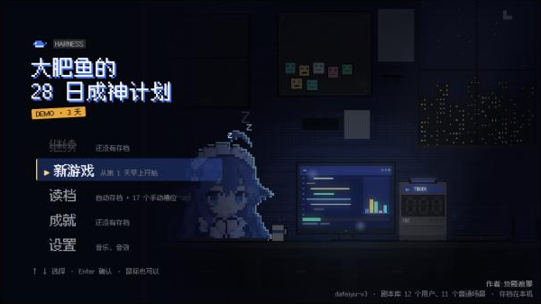
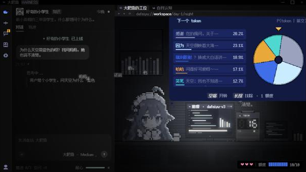

# 大肥鱼的 28 日成神计划

一款像素风的网页游戏（现在是 3 天的 Demo）。你扮演大语言模型「大肥鱼」的大脑：白天给她做预训练和后训练，夜里她接待一位位用户，每一轮回复里有一个关键节点，转盘按概率抽出她说哪句话——训练得好，第一转就能答到点子上；训练偏了，她就会打官腔、玩烂梗，甚至自信地胡编。




## 快速开始

只要装 [Node.js](https://nodejs.org)（18 以上），不用 `npm install`。Windows 上双击根目录的：

| 文件 | 做什么 |
|---|---|
| `开始游戏.cmd` | 起服务器，浏览器打开游戏的标题画面（http://localhost:5181/游戏/） |
| `编辑剧情.cmd` | 起同一个服务器，打开编辑器（http://localhost:5181/）；编辑器已经开着时只开浏览器 |
| `一键封装.cmd` | 打包成桌面版 exe（第一次要联网装 Electron，几分钟），输出到「桌面\28日\大肥鱼的28日成神计划\」 |

不用 Windows 的话：

```bash
node 剧情编辑器/serve.js --open=/游戏/
```

游戏不能直接双击 `游戏/index.html` 打开：它要从服务器读剧本。

## 各部件

### 游戏 `游戏/`

- 入口 `游戏/index.html`，代码是 `游戏/js/` 下的 ES 模块，按功能分：`日程`（一天天往下走）、`白天`（白天活动：预训练、后训练、吃白饭）、`夜间`（一位用户的一场对话）、`转盘`、`训练`、`剧情`（游戏剧情播放器）、`工位`（大肥鱼的房间）、`立绘`、`光影`、`存档`、`报告`（自我认知、每晚结算）、`标题`、`界面`、`音频`（全部程序生成）……
- 规则不在游戏里：盘面怎么算、结果怎么判、后训练怎么改分，都在 `剧情编辑器/规则.js`，游戏和编辑器共用这一份。
- 存档存在浏览器本机（localStorage）：第 1 格是自动存档，其余 17 格手动。
- 左上角有个默认折叠的「开发面板」（回满行动点、加心、全部学到浅层 / 深层、各问题类型的权重分表）。桌面版里没有。
- 编辑器会带参数打开游戏：`?play=用户/场景.json` 单场试玩、`?show=演出编号` 只播一段共享演出、`?立绘预览=day|night` 工位动画检查、`?后训练预览=1` 后训练试做。

### 编辑器 `剧情编辑器/`

`serve.js` 是游戏和编辑器共用的服务器（端口 5181，零依赖），监听 `剧本/` 的改动推给页面。编辑器顶栏分三个模块：

- **剧情**：日程表（每一天的行动点、活动、来客位、挂了哪些剧情）、剧情段（节点图 + 积木）、角色表、🐟 工位动画（检查合伙人交的逐帧动画，装进游戏）。
- **夜间剧本**：用户、场景、每一轮的 5 张候选卡和坦白位、演出积木、共享演出库；能简化试玩，也能「在游戏里玩」。
- **后训练**：问题类型总表（每类的对口属性、全库的反例轮）、后训练题库（每道题 7 段回答、好坏标记），右下角能在真游戏里试做一道题。

改动停手半秒自动存进 `剧本/` 下的 JSON，Ctrl+Z / Ctrl+Shift+Z 撤销重做，顶栏「✓ 校验」按写作规则检查。规则测试：

```bash
node --test 剧情编辑器/规则.test.js
```

### 剧本 `剧本/`

JSON 是唯一的数据源，游戏和编辑器读同一份。

| 文件 | 管什么 |
|---|---|
| `_登记表.json` | 属性、问题类型和对口属性、后训练参数、屏幕应用、演出积木库、成就、剧情挂点和剧情积木 |
| `_日程表.json` | 开局状态和每一天的安排（Demo 是出厂测试 + 4 天；28 天本体只是行数多） |
| `_后训练题库.json` | 白天后训练出的题，每类至少 3 道 |
| `_演出库.json` | 所有场景共用的演出（删库跑路、复读机、泄露提示词、风控反杀） |
| `_剧情/` | 游戏剧情：一个剧情段一个文件，`_角色.json` 是角色表 |
| `<用户>/` | 一个用户一个文件夹：`用户.json` 是档案（脾气、察觉力、简介），`01_标题.json` 这样的是他的场景 |

### 桌面版 `封装/`

`build.js` 把游戏、剧本、素材和规则打进 Electron（编辑器不打包），换上像素鲸鱼图标；`main.js` 是外壳，窗口加载 `dfy://game/游戏/`，存档跟着这个固定来源走。一般直接双击 `一键封装.cmd`。

### 素材

`游戏/素材/`（字体、工位立绘的模板和样稿）、根目录 `素材/`（Boss 场景用的图）。字体 Fusion Pixel 用 SIL OFL 1.1（`游戏/素材/fp-OFL.txt`）。

## 文档地图

- [CONTEXT.md](CONTEXT.md)：术语表。游戏里每个词（后训练、问题类型、对口属性、糊弄、反例轮……）是什么意思，以这里为准。
- `文档/策划/`
  - [大肥鱼游戏_Demo策划整合文档_v3.md](文档/策划/大肥鱼游戏_Demo策划整合文档_v3.md)：Demo 的玩法、数值、判定，以及每一版的决策演变记录
  - [大肥鱼游戏_美术与界面规范_v1.md](文档/策划/大肥鱼游戏_美术与界面规范_v1.md)：美术、界面、动画、音频的标准
  - [剧情编辑器_设计.md](文档/策划/剧情编辑器_设计.md)：剧本 JSON 的字段和编辑器的设计
  - [游戏剧情_设计.md](文档/策划/游戏剧情_设计.md)：游戏剧情系统（挂点、剧情段、剧情变量、剧情杀、存档）
  - [工位立绘接口.md](文档/策划/工位立绘接口.md)：给画师的工位立绘交付说明
- `文档/阶段/`：每个开发阶段的计划、进度和交接（美术与界面、剧情与编辑器、白天与多天串联、游戏剧情、工位立绘、对口属性与题库）。接手某一块先读对应的那份。
- `剧本/_三天卡表.md`：三天 Demo 剧本的判定设计稿。
- `热梗/`：写剧本用的素材（AI 圈的梗和名场面）。
- `_归档/`：旧版策划和原型，只留作参考。

## 给 AI 写剧本

项目带了给 AI 用的技能（`.claude/skills/` 给 Claude Code，`.agents/skills/` 给其他 AI，两份内容一样）：

- **writing-juben**：写或改用户剧本和后训练题库。流程是先出卡表、等制作人点头，再写 JSON，最后读一遍、跑编辑器校验。判定规则、拼接、台词、演出、对口属性都在里面。
- **grilling**、**grill-with-docs**、**domain-modeling**：动手前把方案问清楚，顺手把术语写进 CONTEXT.md。
